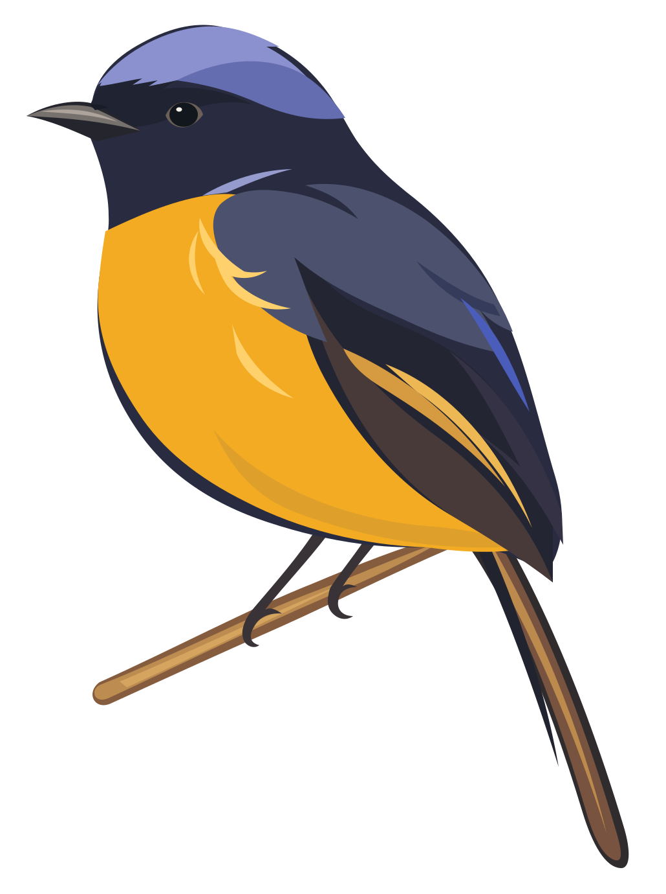

<picture>
  <source media="(prefers-color-scheme: dark)" srcset="docs/assets/niltavi-logo-dark.svg" />
  
</picture>

*Naturalism in the Digital Age*

[ui.niltavi.com](https://ui.niltavi.com/) · [简体中文](docs/README.zh-CN.md)

---

As artificial intelligence carries human possibility ever further, we hope to bring our attention home: to nature, to the senses, to the quiet fact of being here. Technology makes the world more efficient, more precise, more abundant. Nature reminds us how much still asks to be felt firsthand: sunlight sifting through leaves, a passing breeze, a bird alighting on a branch, the small, unbidden moments no calculation can foretell.

Niltavi takes its inspiration from the niltava, a bird of the forest. Clear blue plumage, touched with warm yellow, holds a quiet, living beauty against the depth of green. Here our visual language begins: blue for freedom, clarity, and the urge to explore; yellow for warmth, vitality, and the grace of a chance encounter; forest green for stillness, depth, and a sense of belonging. Drawn from nature, these colors become a language of softness, restraint, and subtle layers, allowing the bright colors of life to emerge from a muted world.

 

We draw from old natural history plates and woodcut prints, giving them new expression in the language of flat vector illustration. Clear contours, unbroken fields of color, and simple geometry lend the image order and lightness. Fine cuts follow the grain of feathers, leaves, and branches, carrying the warmth of a hand at work. We cherish this delicate balance between precision and nature, where the measured forms of the digital world can hold the feeling of a living one.

We believe beauty needs little ornament. The warmth of paper, generous open space, graceful type, and a few considered details are enough to make something quiet and enduring. Every color, every line, every interval of emptiness should earn its place. A design can wait for the eye to find it. It can leave room for looking, for thought, for feeling.

Niltavi seeks a gentle, clear-eyed naturalism for our time. It welcomes the possibilities of technology and treasures the irreplaceable bond between people and the world they inhabit. Through a language of lightness, stillness, and life, we hope to offer an invitation: slow your steps, rediscover the small things growing around you, feel the abundance of being alive, and keep a rhythm of your own as the digital world moves on.

---

> **Let technology widen the possible.** **Let nature awaken the senses.** **Let every lived moment be cherished.**
