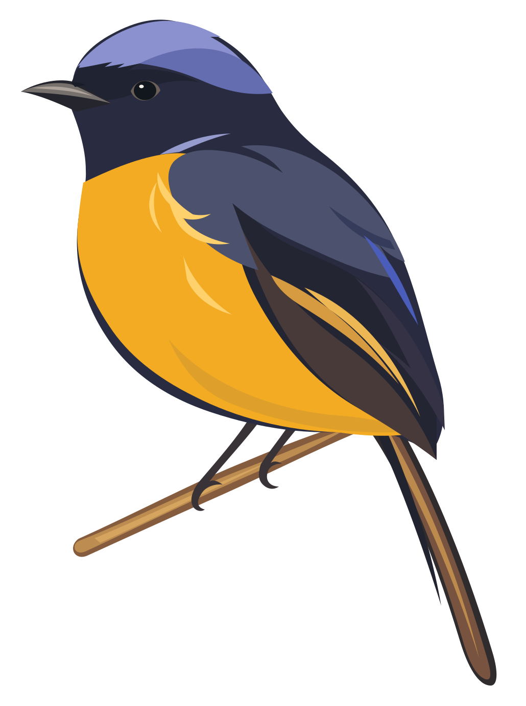

<div align="center">

<a href="https://niltavi.com/">
<picture>
  <source media="(prefers-color-scheme: dark)" srcset="assets/niltavi-logo-dark.svg" />
  
</picture>
</a>

*数字时代的自然主义*

[ui.niltavi.com](https://ui.niltavi.com/) · [English](../README.md)

</div>

---

在人工智能不断拓展人类能力边界的时代，我们希望重新唤起人们对自然、感知与自我体验的关注。技术让世界变得更加高效、精确和丰富，而自然提醒我们，生活中仍有许多值得亲自感受的事物：一束穿过树叶的阳光、一阵微风、一只偶然停留在枝头的鸟，以及那些无法被预先计算的细微瞬间。



Niltavi [nɪlˈtɑːvi] 的灵感来自栖息于森林中的仙鹟。它拥有鲜明而纯净的蓝色羽毛，点缀着温暖的黄色，在深邃的森林绿意之间呈现出一种安静而生动的美。这种色彩关系构成了我们的视觉起点：以蓝色表达自由、清澈与探索，以黄色传递温度、生命力与偶然的惊喜，以森林绿承载自然的深度、宁静与归属感。我们将这些源于自然的颜色转化为克制、柔和而富有层次的视觉语言，让鲜明的生命色彩在低饱和的环境中自然浮现。

<br clear="right" />

在表现形式上，我们从传统自然博物图鉴与木刻版画中汲取灵感，并以现代平面矢量语言重新诠释。清晰的轮廓、纯粹的色块与简洁的几何构图，赋予画面现代设计的秩序与轻盈；羽毛、枝叶之间细腻而富有方向感的刻线，则保留了传统手工艺术的温度与生命感。我们珍视这种精确与自然之间的微妙平衡，让理性的数字形式承载感性的自然表达。

我们相信，质感无需依赖繁复的装饰。温暖的纸张底色、舒展的留白、优雅的文字与克制的细节，足以营造一种安静而持久的美。画面中的每一种颜色、每一道线条、每一处空白，都应当拥有存在的理由。设计不急于吸引注意，也不试图填满所有空间，而是为观看、思考与感受留下余地。

Niltavi 所追求的是一种温和而清醒的现代自然主义。它拥抱技术带来的可能性，也珍视人类与真实世界之间不可替代的联系。我们希望通过一种轻盈、宁静、富有生命力的设计语言，邀请人们暂时放慢脚步，重新发现自然的细节，感受生活本身的丰富，并在不断变化的数字世界中，保留属于自己的节奏。

## Agent Skill

让编程助手掌握 Niltavi 的约定：

```bash
npx skills add niltavi/niltavi-ui
```

在 Claude Code 中调用 `/niltavi-ui`（Codex 中为 `$niltavi-ui`）。Skill 始终以 [ui.niltavi.com](https://ui.niltavi.com/) 与本仓库的最新约定为准，详见 [Skills](https://ui.niltavi.com/#/skills)。

---

> **让技术拓展可能，**<br />**让自然唤醒感知，**<br />**让每一次真实的体验都值得被珍视。**
